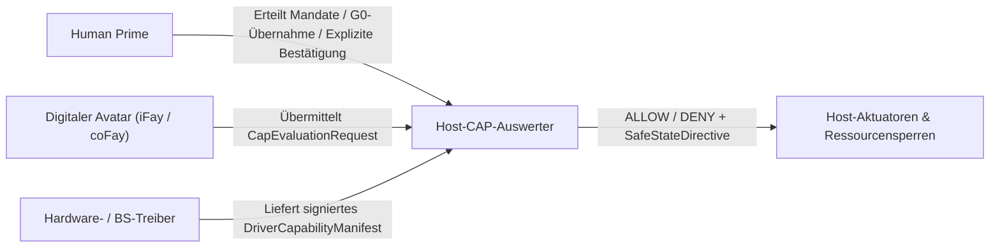

# Kapitel 1: Architektur und Bindungsmodelle

## 1.1 Vertrauensmodell und Rolle als Relying Party

CAP **DARF KEINE** (**SHALL NOT**) eigenständige Identitätswurzel errichten und die Semantik menschlicher Delegation nicht neu definieren; stattdessen agiert CAP innerhalb der vertrauenswürdigen Ausführungsumgebung des **Host** als **Relying Party** gegenüber `Faying-Protocol`:

1. Der **Human Prime** (`Menschliches Primärsubjekt`) bildet den alleinigen Ursprung jeglicher Kontrolllegitimität und behält jederzeit das verzögerungsfreie `G0`-Vorrangrecht über den Host.
2. Der **Host-Treiber** legt über ein Ed25519-signiertes, in lokalen Vertrauensankern (`Trust Anchors`) verankertes `DriverCapabilityManifest` die nicht herabstufbare Kritikalitätsuntergrenze sowie das Verzeichnis sicherer Zustände für jede Ressourcenoperation fest.
3. Der **digitale Avatar (`Fay`)** gilt als nicht vertrauenswürdiger Aufrufer, der durch Prompt-Injektion, Kontextmanipulation oder Fehlableitungen kompromittiert sein kann: Der CAP-Auswerter **DARF** vom Aufrufer übermittelten Kritikalitätsherabstufungen oder nicht attestierten Bestätigungsbehauptungen **NICHT** (**MUST NOT**) vertrauen.

---

## 1.2 Deterministische Kurzschluss-Auswertungspipeline (Default-Deny)

Für jede eingehende `CapEvaluationRequest` **MUSS** (**MUST**) der CAP-Auswerter die nachfolgende achtstufige Kurzschlusspipeline exakt in der angegebenen Reihenfolge abarbeiten; schlägt eine Stufe fehl, **MUSS** (**MUST**) die Auswertung sofort abgebrochen und `DENY` zurückgegeben werden:

1. **Prüfung der Protokollversion**: Sicherstellen, dass `protocol_version == "1.0"` gilt; andernfalls Rückgabe von `E_PROTOCOL_VERSION_UNSUPPORTED` (`2098`).
2. **Prüfung der Geltungsbereichsgrenze**: Gilt auf oberster Ebene `domain_category == "fund_transfer"`, sofortige Rückgabe von `E_OUT_OF_SCOPE_FUND_TRANSFER` (`2007`).
3. **Signaturprüfung des Treiber-Fähigkeitsmanifests**: Prüfung der Ed25519-Signatur von `manifest` gegen `trust_anchors`; bei Fehlschlag Rückgabe von `E_UNTRUSTED_MANIFEST` (`2005`).
4. **Operationsauflösung und Ableitung der wirksamen Kritikalität**: Nachschlagen von `resource_id` und `operation_id` im verifizierten Manifest (fehlt der Eintrag, Rückgabe von `E_UNKNOWN_OPERATION` `2004`; deklariert die Operation `domain_category == "fund_transfer"`, Rückgabe von `E_OUT_OF_SCOPE_FUND_TRANSFER` `2007`), anschließend Berechnung von `effective_criticality` und `escalation_clamped` anhand der Irreversibilitätsuntergrenze und monotoner Überschreibungen.
5. **`G0`-Vorrangunterbrechung durch den Human Prime**: Gilt `g0_override == true` oder `grant.mandate_binding.session_grade == "G0"`, sofortige Rückgabe von `E_G0_EMERGENCY_OVERRIDE` (`2003`) samt blockierungsfreier `safe_state_directive`.
6. **Prüfung der Gültigkeit und Bindungsstärke des Faying-Mandats**: Überprüfung von Ablaufzeitpunkt, Widerrufskennzeichen sowie Subjekt-, Ressourcen- und Modusübereinstimmung (bei Abweichung Rückgabe von `E_MANDATE_INVALID` `2008`); danach Prüfung der für `effective_criticality` geforderten Bindungsmodellstärke (bei unzureichender Bindung Rückgabe von `E_WEAK_MANDATE_BINDING` `2001`).
7. **Prüfung der dreidimensionalen Stufenmatrix**: Sicherstellen, dass `session_grade` sowohl `grant.min_grade` als auch die Matrix `FayingGrade × AccessMode × Criticality` erfüllt; andernfalls Rückgabe von `E_GRADE_INSUFFICIENT` (`2002`).
8. **Parametergebundenes Bestätigungsgatter des Human Prime**: Ist `effective_criticality` gleich `high` oder `critical`, Überprüfung von Identitätssyntax, zeitlicher Frische, Host-attestierter Offenlegung und Parameter-SHA-256-Prüfsumme in `human_confirmation`; andernfalls Rückgabe von `E_CONFIRMATION_REQUIRED` (`2006`).

Nur wenn alle acht Prüfstufen erfolgreich durchlaufen wurden, **DARF** (**SHALL**) der Auswerter `decision = "ALLOW"` zusammen mit `effective_criticality`, `effective_grade` und `escalation_clamped` zurückgeben.

---

## 1.3 Grundinvarianten der Faying-Mandatszuordnung

`CapGrant.mandate_binding` (`MandateEvidence`) verknüpft die Kontrollanfrage mit einer aktiven vorgelagerten Delegation. Der Auswerter **MUSS** (**MUST**) sämtliche nachstehenden Bedingungen prüfen und bei jedem Verstoß `E_MANDATE_INVALID` (`2008`) liefern:

- `mandate.revoked == false`;
- `mandate.expires_at_epoch_ms > req.now_epoch_ms` (Zeitstempel kleiner oder gleich `now_epoch_ms` gelten als abgelaufen);
- `mandate.fay_id == req.fay_id`;
- `mandate.resource_id == req.resource_id` sowie `req.grant.resource_id == req.resource_id`;
- `OperationDescriptor.mode == req.requested_mode` im verifizierten Manifest;
- Sowohl `req.grant.allowed_modes` als auch `mandate.allowed_modes` enthalten `req.requested_mode`.

---

## 1.4 Mandatsbindungsmodelle und Beschränkungen für hohe Kritikalität

CAP 1.0 definiert drei `MandateBindingModel`-Werte, deren Zulässigkeit sich nach `effective_criticality` richtet:

| Bindungsmodell | Kryptografische und Aktualitätsanforderungen | Höchste zulässige Kritikalität | Fehlercode bei Verstoß |
|----------------|----------------------------------------------|--------------------------------|------------------------|
| `model_a_plus_b` | Echtzeit-Mandatsfrische `online_fresh == true` **UND** kryptografischer sitzungsabgeleiteter Nachweis `model_a_derived_proof_valid == true` | `routine`, `sensitive`, `high`, `critical` (**einzig zulässiges Modell für `high` und `critical`**) | `E_WEAK_MANDATE_BINDING` (`2001`), falls unter `high`/`critical` `online_fresh != true` oder `model_a_derived_proof_valid != true`; `E_MANDATE_INVALID` (`2008`), falls unter `routine`/`sensitive` `online_fresh != true` |
| `model_b_online_ref` | Aktive Mandatsreferenz mit Echtzeit-Widerrufs- und Aktualitätsprüfung (`online_fresh == true`) | `routine`, `sensitive` (Standard-Online-Basis von CAP 1.0) | **MUSS** (`MUST`) bei `high` oder `critical` `E_WEAK_MANDATE_BINDING` (`2001`) liefern; liefert `E_MANDATE_INVALID` (`2008`), falls `online_fresh != true` |
| `model_c_offline_cache` | Lokal zwischengespeicherter Offline-Berechtigungsnachweis ohne Echtzeit-Frischenachweis | **ausschließlich `routine`** | **MUSS** (`MUST`) bei `sensitive`, `high` oder `critical` `E_WEAK_MANDATE_BINDING` (`2001`) liefern |

**Normative Invariante**: Eine Host-Implementierung **DARF KEINE** (**SHALL NOT**) `high`- oder `critical`-Operation auf Grundlage eines offline zwischengespeicherten Nachweises (`model_c_offline_cache`) oder einer ungebundenen Online-Referenz (`model_b_online_ref`) freigeben.

---

## 1.5 Ausschluss finanzieller Geldtransfers

CAP regelt physische Aktuatoren, Betriebssystemressourcen, Kommunikationsschnittstellen, Speichermedien und Firmware-Aktualisierungen. Damit allgemeine Gerätesteuerungskanäle keine spezialisierten Finanzrisikokontrollen umgehen:

- Unabhängig von Sitzungsstufe oder Bestätigungsnachweisen **MUSS** (**MUST**) der CAP-Auswerter jede Anfrage mit `CapEvaluationRequest.domain_category == "fund_transfer"` oder `OperationDescriptor.domain_category == "fund_transfer"` ausnahmslos mit `effective_criticality = "critical"`, `error_code = "E_OUT_OF_SCOPE_FUND_TRANSFER"` und `diagnostic_code = 2007` ablehnen.
