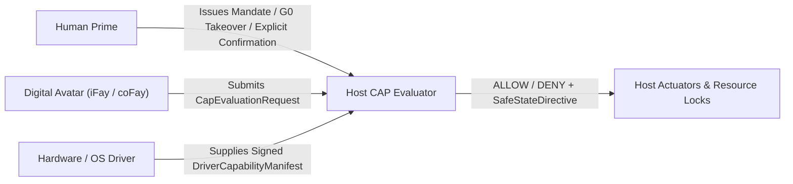

# Chapter 1: Architecture and Binding Models

## 1.1 Trust Model and Relying Party Role

CAP **SHALL NOT** establish a standalone identity root or redefine human delegation semantics; instead, CAP operates inside the **Host** trusted execution boundary as a **Relying Party** to `Faying-Protocol`:

1. The **Human Prime** is the sole root of control legitimacy and retains unconditional, zero-latency `G0` preemption over the Host at all times.
2. The **Host Driver** establishes the non-downgradable criticality floor and safe-state catalog for each resource operation through an Ed25519-signed `DriverCapabilityManifest` anchored in local Trust Anchors.
3. The **Digital Avatar (`Fay`)** is treated as an untrusted caller potentially subject to prompt injection, context poisoning, or reasoning drift: the CAP Evaluator **MUST NOT** trust caller-supplied criticality downgrades or unattested confirmation claims.

---

## 1.2 Default-Deny Short-Circuit Evaluation Pipeline

For every incoming `CapEvaluationRequest`, the CAP Evaluator **MUST** execute the following deterministic short-circuit pipeline in exact order; failure at any stage **MUST** immediately terminate evaluation and return `DENY`:

1. **Protocol Version Check**: Verify `protocol_version == "1.0"`; otherwise return `E_PROTOCOL_VERSION_UNSUPPORTED` (`2098`).
2. **Scope Boundary Filter**: If top-level `domain_category == "fund_transfer"`, immediately return `E_OUT_OF_SCOPE_FUND_TRANSFER` (`2007`).
3. **Driver Capability Manifest Signature Verification**: Verify the Ed25519 signature of `manifest` against `trust_anchors`; on failure return `E_UNTRUSTED_MANIFEST` (`2005`).
4. **Operation Lookup and Effective Criticality Derivation**: Locate `resource_id` and `operation_id` in the verified manifest (if absent, return `E_UNKNOWN_OPERATION` `2004`; if the operation declares `domain_category == "fund_transfer"`, return `E_OUT_OF_SCOPE_FUND_TRANSFER` `2007`), then compute `effective_criticality` and `escalation_clamped` from the irreversibility floor and monotonic overrides.
5. **`G0` Human Prime Emergency Takeover Preemption**: If `g0_override == true` or `grant.mandate_binding.session_grade == "G0"`, immediately return `E_G0_EMERGENCY_OVERRIDE` (`2003`) together with a non-blocking `safe_state_directive`.
6. **Faying Mandate Validity and Binding Model Check**: Verify expiration, revocation flag, and subject/resource/mode alignment (returning `E_MANDATE_INVALID` `2008` on mismatch), then enforce binding-model strength for `effective_criticality` (returning `E_WEAK_MANDATE_BINDING` `2001` if insufficient).
7. **Three-Dimensional Grade Matrix Check**: Verify `session_grade` satisfies both `grant.min_grade` and the `FayingGrade × AccessMode × Criticality` matrix; otherwise return `E_GRADE_INSUFFICIENT` (`2002`).
8. **Parameter-Bound Explicit Human Prime Confirmation Gate**: Whenever `effective_criticality` is `high` or `critical`, verify `human_confirmation` identity syntax, freshness, terminal-attested disclosure, and parameter SHA-256 digest; otherwise return `E_CONFIRMATION_REQUIRED` (`2006`).

Only when all eight checks succeed **SHALL** the Evaluator return `decision = "ALLOW"` populated with `effective_criticality`, `effective_grade`, and `escalation_clamped`.

---

## 1.3 Baseline Faying Mandate Alignment Invariants

`CapGrant.mandate_binding` (`MandateEvidence`) binds the control request to an active upstream delegation. The Evaluator **MUST** verify every condition below and return `E_MANDATE_INVALID` (`2008`) if any check fails:

- `mandate.revoked == false`;
- `mandate.expires_at_epoch_ms > req.now_epoch_ms` (timestamps less than or equal to `now_epoch_ms` are expired);
- `mandate.fay_id == req.fay_id`;
- `mandate.resource_id == req.resource_id` and `req.grant.resource_id == req.resource_id`;
- The verified manifest's `OperationDescriptor.mode == req.requested_mode`;
- Both `req.grant.allowed_modes` and `mandate.allowed_modes` contain `req.requested_mode`.

---

## 1.4 Mandate Binding Models and High-Criticality Restrictions

CAP 1.0 defines three `MandateBindingModel` values governed by `effective_criticality`:

| Binding Model | Cryptographic & Liveness Requirements | Maximum Permitted Criticality | Violation Error Code |
|---------------|---------------------------------------|-------------------------------|----------------------|
| `model_a_plus_b` | Live mandate freshness `online_fresh == true` **AND** cryptographic session-derived proof `model_a_derived_proof_valid == true` | `routine`, `sensitive`, `high`, `critical` (**sole permitted model for `high` and `critical`**) | `E_WEAK_MANDATE_BINDING` (`2001`) if `online_fresh != true` or `model_a_derived_proof_valid != true` under `high`/`critical`; `E_MANDATE_INVALID` (`2008`) if `online_fresh != true` under `routine`/`sensitive` |
| `model_b_online_ref` | Live Mandate reference with real-time revocation and freshness verification (`online_fresh == true`) | `routine`, `sensitive` (default CAP 1.0 online baseline) | **MUST** return `E_WEAK_MANDATE_BINDING` (`2001`) when used for `high` or `critical`; returns `E_MANDATE_INVALID` (`2008`) if `online_fresh != true` |
| `model_c_offline_cache` | Offline locally cached authorization credential without live freshness proof | **`routine` only** | **MUST** return `E_WEAK_MANDATE_BINDING` (`2001`) when used for `sensitive`, `high`, or `critical` |

**Normative Invariant**: A Host implementation **SHALL NOT** authorize any `high` or `critical` operation using an offline cached credential (`model_c_offline_cache`) or an unbound online reference (`model_b_online_ref`).

---

## 1.5 Financial Fund-Transfer Exclusion

CAP governs physical actuators, operating-system resources, communication peripherals, storage media, and firmware updates. To prevent general-purpose device control channels from bypassing dedicated financial risk controls:

- Regardless of session grade or confirmation proofs, if `CapEvaluationRequest.domain_category == "fund_transfer"` or the target `OperationDescriptor.domain_category == "fund_transfer"`, the CAP Evaluator **MUST** unconditionally deny the request with `effective_criticality = "critical"`, `error_code = "E_OUT_OF_SCOPE_FUND_TRANSFER"`, and `diagnostic_code = 2007`.
