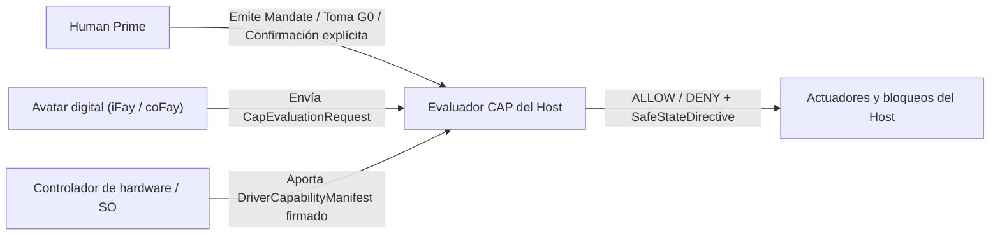

# Capítulo 1: Arquitectura y modelos de vinculación

## 1.1 Modelo de confianza y rol como parte confiante

CAP **NO DEBE** (**SHALL NOT**) establecer una raíz de identidad independiente ni redefinir la semántica de delegación humana; por el contrario, opera dentro de la frontera de ejecución confiable del **Host** como **parte confiante** (*Relying Party*) de `Faying-Protocol`:

1. El **Human Prime** constituye la única raíz de legitimidad de control y conserva en todo instante la preempción `G0` sin latencia sobre el Host.
2. El **controlador del Host** fija el piso no degradable de criticidad y el catálogo de estados seguros de cada operación mediante un `DriverCapabilityManifest` firmado con Ed25519 y anclado en las anclas de confianza locales (`Trust Anchors`).
3. El **avatar digital (`Fay`)** se trata como un invocador no confiable expuesto a inyección de instrucciones, contaminación de contexto o deriva de razonamiento: el Evaluador CAP **NO DEBE** (**MUST NOT**) confiar en rebajas de criticidad declaradas por el invocador ni en afirmaciones de confirmación no atestiguadas por el Host.

---

## 1.2 Tubería determinista de evaluación en cortocircuito (*Default-Deny*)

Para cada `CapEvaluationRequest` entrante, el Evaluador CAP **DEBE** (**MUST**) ejecutar la siguiente tubería determinista de 8 pasos en orden estricto; el fallo en cualquier etapa **DEBE** (**MUST**) interrumpir de inmediato la evaluación y devolver `DENY`:

1. **Verificación de versión de protocolo**: Comprobar `protocol_version == "1.0"`; en caso contrario devolver `E_PROTOCOL_VERSION_UNSUPPORTED` (`2098`).
2. **Filtro de frontera de alcance**: Si en el nivel raíz `domain_category == "fund_transfer"`, devolver de inmediato `E_OUT_OF_SCOPE_FUND_TRANSFER` (`2007`).
3. **Verificación de firma del manifiesto del controlador**: Verificar la firma Ed25519 de `manifest` frente a `trust_anchors`; si falla, devolver `E_UNTRUSTED_MANIFEST` (`2005`).
4. **Búsqueda de operación y cálculo de criticidad efectiva**: Localizar `resource_id` y `operation_id` en el manifiesto verificado (si no existen, devolver `E_UNKNOWN_OPERATION` `2004`; si la operación declara `domain_category == "fund_transfer"`, devolver `E_OUT_OF_SCOPE_FUND_TRANSFER` `2007`) y calcular `effective_criticality` junto con `escalation_clamped` a partir del piso de irreversibilidad y las sobreescrituras monótonas.
5. **Preempción de emergencia `G0` del Human Prime**: Si `g0_override == true` o `grant.mandate_binding.session_grade == "G0"`, devolver de inmediato `E_G0_EMERGENCY_OVERRIDE` (`2003`) acompañado de un `safe_state_directive` no bloqueante.
6. **Validación del mandato Faying y del modelo de vinculación**: Comprobar vigencia temporal, indicador de revocación y concordancia de sujeto, recurso y modo (devolviendo `E_MANDATE_INVALID` `2008` ante cualquier discrepancia), y exigir la fortaleza del modelo de vinculación correspondiente a `effective_criticality` (devolviendo `E_WEAK_MANDATE_BINDING` `2001` cuando sea insuficiente).
7. **Verificación de la matriz tridimensional de grados**: Comprobar que `session_grade` satisface tanto `grant.min_grade` como la matriz `FayingGrade × AccessMode × Criticality`; de lo contrario devolver `E_GRADE_INSUFFICIENT` (`2002`).
8. **Compuerta de confirmación explícita del Human Prime vinculada a parámetros**: Cuando `effective_criticality` sea `high` o `critical`, validar en `human_confirmation` la sintaxis de identidad, la vigencia temporal, la divulgación atestiguada por el Host y el resumen SHA-256 de parámetros; en caso contrario devolver `E_CONFIRMATION_REQUIRED` (`2006`).

Únicamente cuando las ocho comprobaciones culminan con éxito **DEBE** (**SHALL**) el Evaluador devolver `decision = "ALLOW"` con `effective_criticality`, `effective_grade` y `escalation_clamped`.

---

## 1.3 Invariantes base de alineación del mandato Faying

`CapGrant.mandate_binding` (`MandateEvidence`) vincula la solicitud de control con una delegación activa aguas arriba. El Evaluador **DEBE** (**MUST**) verificar todas las condiciones siguientes y devolver `E_MANDATE_INVALID` (`2008`) si cualquiera de ellas falla:

- `mandate.revoked == false`;
- `mandate.expires_at_epoch_ms > req.now_epoch_ms` (una marca temporal menor o igual que `now_epoch_ms` se considera vencida);
- `mandate.fay_id == req.fay_id`;
- `mandate.resource_id == req.resource_id` y `req.grant.resource_id == req.resource_id`;
- `OperationDescriptor.mode == req.requested_mode` en el manifiesto verificado;
- Tanto `req.grant.allowed_modes` como `mandate.allowed_modes` contienen `req.requested_mode`.

---

## 1.4 Modelos de vinculación de mandato y restricciones para alta criticidad

CAP 1.0 define tres valores de `MandateBindingModel` regidos por `effective_criticality`:

| Modelo de vinculación | Requisitos criptográficos y de frescura | Criticidad máxima permitida | Código de error en caso de infracción |
|-----------------------|-----------------------------------------|-----------------------------|---------------------------------------|
| `model_a_plus_b` | Vigencia en línea `online_fresh == true` **Y** prueba criptográfica derivada de sesión `model_a_derived_proof_valid == true` | `routine`, `sensitive`, `high`, `critical` (**único modelo admitido para `high` y `critical`**) | `E_WEAK_MANDATE_BINDING` (`2001`) si `online_fresh != true` o `model_a_derived_proof_valid != true` bajo `high`/`critical`; `E_MANDATE_INVALID` (`2008`) si `online_fresh != true` bajo `routine`/`sensitive` |
| `model_b_online_ref` | Referencia activa al Mandate con verificación en tiempo real de revocación y vigencia (`online_fresh == true`) | `routine`, `sensitive` (línea base en línea predeterminada de CAP 1.0) | **DEBE** (`MUST`) devolver `E_WEAK_MANDATE_BINDING` (`2001`) si se emplea para `high` o `critical`; devuelve `E_MANDATE_INVALID` (`2008`) si `online_fresh != true` |
| `model_c_offline_cache` | Credencial de autorización almacenada en caché local sin prueba de vigencia en vivo | **exclusivamente `routine`** | **DEBE** (`MUST`) devolver `E_WEAK_MANDATE_BINDING` (`2001`) si se emplea para `sensitive`, `high` o `critical` |

**Invariante normativa**: Ninguna implementación en el Host **DEBE** (**SHALL NOT**) autorizar operaciones `high` ni `critical` mediante credenciales en caché sin conexión (`model_c_offline_cache`) ni referencias en línea sin subprueba derivada (`model_b_online_ref`).

---

## 1.5 Exclusión de transferencias financieras de fondos

CAP gobierna actuadores físicos, recursos del sistema operativo, periféricos de comunicación, medios de almacenamiento y actualizaciones de firmware. Para impedir que los canales generales de control de dispositivos eludan controles especializados de riesgo financiero:

- Con independencia del grado de sesión o de las pruebas de confirmación presentadas, si `CapEvaluationRequest.domain_category == "fund_transfer"` o `OperationDescriptor.domain_category == "fund_transfer"`, el Evaluador CAP **DEBE** (**MUST**) denegar incondicionalmente la solicitud con `effective_criticality = "critical"`, `error_code = "E_OUT_OF_SCOPE_FUND_TRANSFER"` y `diagnostic_code = 2007`.
