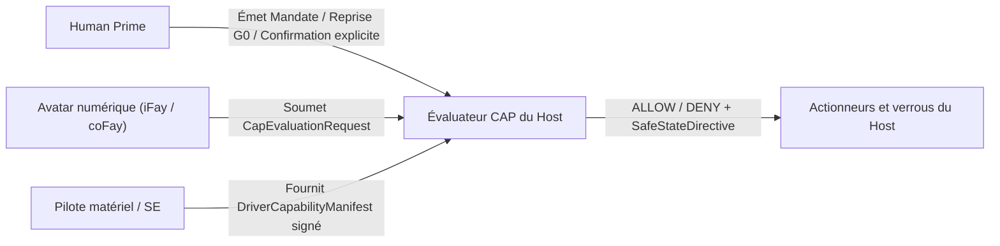

# Chapitre 1 : Architecture et modèles de liaison

## 1.1 Modèle de confiance et rôle de partie utilisatrice

CAP **NE DOIT PAS** (**SHALL NOT**) instituer une racine d'identité autonome ni redéfinir la sémantique de délégation humaine ; il opère au sein de la frontière d'exécution de confiance du **Host** en qualité de **partie utilisatrice** (*Relying Party*) de `Faying-Protocol` :

1. Le **Human Prime** constitue l'unique source de légitimité du contrôle et conserve à tout instant une préemption `G0` sans latence sur le Host.
2. Le **pilote du Host** établit le plancher non rétrogradable de criticité ainsi que le catalogue d'états sûrs de chaque opération au moyen d'un `DriverCapabilityManifest` signé en Ed25519 et ancré dans les ancres de confiance locales (`Trust Anchors`).
3. L'**avatar numérique (`Fay`)** est traité comme un appelant non fiable susceptible de subir une injection d'invite, une altération de contexte ou une dérive de raisonnement : l'Évaluateur CAP **NE DOIT PAS** (**MUST NOT**) accorder foi aux rétrogradations de criticité soumises par l'appelant ni aux affirmations de confirmation non attestées par le Host.

---

## 1.2 Pipeline déterministe d'évaluation en court-circuit (*Default-Deny*)

Pour chaque `CapEvaluationRequest` entrante, l'Évaluateur CAP **DOIT** (**MUST**) exécuter le pipeline déterministe en 8 étapes ci-dessous dans cet ordre exact ; tout échec à une étape quelconque **DOIT** (**MUST**) interrompre immédiatement l'évaluation et renvoyer `DENY` :

1. **Vérification de la version de protocole** : Vérifier `protocol_version == "1.0"` ; sinon renvoyer `E_PROTOCOL_VERSION_UNSUPPORTED` (`2098`).
2. **Filtre de périmètre fonctionnel** : Si au niveau racine `domain_category == "fund_transfer"`, renvoyer immédiatement `E_OUT_OF_SCOPE_FUND_TRANSFER` (`2007`).
3. **Vérification de signature du manifeste de pilote** : Vérifier la signature Ed25519 de `manifest` par rapport à `trust_anchors` ; en cas d'échec, renvoyer `E_UNTRUSTED_MANIFEST` (`2005`).
4. **Recherche d'opération et calcul de la criticité effective** : Rechercher `resource_id` et `operation_id` dans le manifeste vérifié (s'ils sont absents, renvoyer `E_UNKNOWN_OPERATION` `2004` ; si l'opération déclare `domain_category == "fund_transfer"`, renvoyer `E_OUT_OF_SCOPE_FUND_TRANSFER` `2007`), puis calculer `effective_criticality` et `escalation_clamped` à partir du plancher d'irréversibilité et des surcharges monotones.
5. **Préemption d'urgence `G0` du Human Prime** : Si `g0_override == true` ou `grant.mandate_binding.session_grade == "G0"`, renvoyer immédiatement `E_G0_EMERGENCY_OVERRIDE` (`2003`) accompagné d'une `safe_state_directive` non bloquante.
6. **Vérification de validité du mandat Faying et du modèle de liaison** : Contrôler l'expiration, l'indicateur de révocation ainsi que la concordance de sujet, de ressource et de mode (renvoyant `E_MANDATE_INVALID` `2008` en cas d'écart), puis exiger la solidité du modèle de liaison requise par `effective_criticality` (renvoyant `E_WEAK_MANDATE_BINDING` `2001` en cas d'insuffisance).
7. **Vérification de la matrice tridimensionnelle de grades** : Vérifier que `session_grade` satisfait à la fois `grant.min_grade` et la matrice `FayingGrade × AccessMode × Criticality` ; sinon renvoyer `E_GRADE_INSUFFICIENT` (`2002`).
8. **Porte de confirmation explicite du Human Prime liée aux paramètres** : Lorsque `effective_criticality` vaut `high` ou `critical`, vérifier dans `human_confirmation` la syntaxe d'identité, la fraîcheur temporelle, la divulgation attestée par le Host et le condensat SHA-256 des paramètres ; sinon renvoyer `E_CONFIRMATION_REQUIRED` (`2006`).

Ce n'est que lorsque les huit contrôles réussissent que l'Évaluateur **DOIT** (**SHALL**) renvoyer `decision = "ALLOW"` renseigné avec `effective_criticality`, `effective_grade` et `escalation_clamped`.

---

## 1.3 Invariants d'alignement du mandat Faying

`CapGrant.mandate_binding` (`MandateEvidence`) relie la demande de contrôle à une délégation active en amont. L'Évaluateur **DOIT** (**MUST**) vérifier chacune des conditions suivantes et renvoyer `E_MANDATE_INVALID` (`2008`) dès qu'une condition échoue :

- `mandate.revoked == false` ;
- `mandate.expires_at_epoch_ms > req.now_epoch_ms` (une estampille inférieure ou égale à `now_epoch_ms` est considérée comme expirée) ;
- `mandate.fay_id == req.fay_id` ;
- `mandate.resource_id == req.resource_id` et `req.grant.resource_id == req.resource_id` ;
- `OperationDescriptor.mode == req.requested_mode` dans le manifeste vérifié ;
- `req.grant.allowed_modes` et `mandate.allowed_modes` contiennent tous deux `req.requested_mode`.

---

## 1.4 Modèles de liaison de mandat et restrictions de haute criticité

CAP 1.0 définit trois valeurs de `MandateBindingModel` encadrées par `effective_criticality` :

| Modèle de liaison | Exigences cryptographiques et de fraîcheur | Criticité maximale autorisée | Code d'erreur en cas de violation |
|-------------------|--------------------------------------------|------------------------------|-----------------------------------|
| `model_a_plus_b` | Fraîcheur en direct `online_fresh == true` **ET** preuve cryptographique dérivée de session `model_a_derived_proof_valid == true` | `routine`, `sensitive`, `high`, `critical` (**seul modèle admis pour `high` et `critical`**) | `E_WEAK_MANDATE_BINDING` (`2001`) si `online_fresh != true` ou `model_a_derived_proof_valid != true` sous `high`/`critical` ; `E_MANDATE_INVALID` (`2008`) si `online_fresh != true` sous `routine`/`sensitive` |
| `model_b_online_ref` | Référence active au Mandate avec vérification en temps réel de révocation et de fraîcheur (`online_fresh == true`) | `routine`, `sensitive` (socle en ligne par défaut de CAP 1.0) | **DOIT** (`MUST`) renvoyer `E_WEAK_MANDATE_BINDING` (`2001`) lorsqu'il est utilisé pour `high` ou `critical` ; renvoie `E_MANDATE_INVALID` (`2008`) si `online_fresh != true` |
| `model_c_offline_cache` | Justificatif d'autorisation mis en cache localement hors ligne sans preuve de fraîcheur en direct | **`routine` uniquement** | **DOIT** (`MUST`) renvoyer `E_WEAK_MANDATE_BINDING` (`2001`) lorsqu'il est utilisé pour `sensitive`, `high` ou `critical` |

**Invariant normatif** : Aucune implémentation sur le Host **NE DOIT** (**SHALL NOT**) autoriser une opération `high` ou `critical` sur la foi d'un justificatif hors ligne mis en cache (`model_c_offline_cache`) ou d'une simple référence en ligne non assortie d'une sous-preuve dérivée (`model_b_online_ref`).

---

## 1.5 Exclusion des transferts financiers de fonds

CAP encadre les actionneurs physiques, les ressources du système d'exploitation, les périphériques de communication, les supports de stockage et les mises à jour de micrologiciels. Afin d'empêcher les canaux généraux de contrôle d'équipements de contourner les dispositifs dédiés de maîtrise des risques financiers :

- Quels que soient le grade de session ou les preuves de confirmation fournies, si `CapEvaluationRequest.domain_category == "fund_transfer"` ou si `OperationDescriptor.domain_category == "fund_transfer"`, l'Évaluateur CAP **DOIT** (**MUST**) rejeter inconditionnellement la requête avec `effective_criticality = "critical"`, `error_code = "E_OUT_OF_SCOPE_FUND_TRANSFER"` et `diagnostic_code = 2007`.
