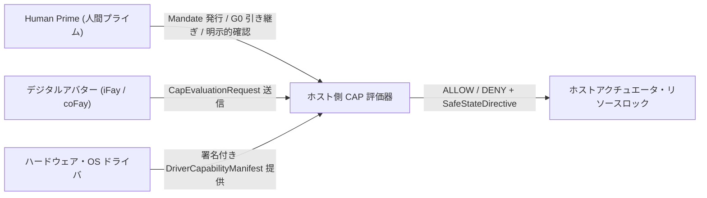

# 第 1 章：アーキテクチャとバインディングモデル

## 1.1 信頼モデルと依拠当事者（Relying Party）としての位置付け

CAP は独自の ID ルートや人間認可発行基盤を再定義してはならず（**SHALL NOT**）、ホスト（`Host`）の信頼実行境界内で動作する `Faying-Protocol` の**依拠当事者（Relying Party）**として機能する。

1. **`Human Prime`（人間プライム）** はすべての制御権限の唯一の正当性根拠であり、いかなる時点でも無条件にホスト制御権を奪還する `G0` 最優先特権を保持する。
2. **ホスト側ドライバ（Driver）** は信頼アンカー（Trust Anchor）により Ed25519 署名された `DriverCapabilityManifest` を通じて、各リソース操作の重大度下限および安全状態を宣言する。
3. **デジタルアバター（`Fay`）** はプロンプトインジェクション、コンテキスト汚染、または推論ハルシネーションの影響を受け得る潜在的非信頼呼び出し元として扱われる。CAP 評価器は `Fay` が自己申告する重大度引き下げや、端末証明のない確認主張を信用してはならない（**MUST NOT**）。

---

## 1.2 デフォルト拒否（Default-Deny）短絡評価パイプライン

各 `CapEvaluationRequest` に対し、CAP 評価器は以下の固定順序で決定論的な短絡評価を実行しなければならない（**MUST**）。いずれかのステップが失敗した場合、後続ステップを直ちに打ち切り `DENY` を返さなければならない（**MUST**）。

1. **プロトコルバージョン検証**：`protocol_version == "1.0"` であることを確認する。不一致の場合は `E_PROTOCOL_VERSION_UNSUPPORTED`（`2098`）を返す。
2. **プロトコル適用範囲境界の遮断**：リクエスト最上位の `domain_category == "fund_transfer"` である場合、直ちに `E_OUT_OF_SCOPE_FUND_TRANSFER`（`2007`）を返す。
3. **ドライバ能力マニフェストの署名検証**：ローカル信頼アンカーを用いて `manifest` の Ed25519 署名を検証し、失敗時は `E_UNTRUSTED_MANIFEST`（`2005`）を返す。
4. **操作検索と実効重大度の算出**：検証済みマニフェストから `resource_id` と `operation_id` を検索し（未宣言なら `E_UNKNOWN_OPERATION` `2004`、操作定義が `domain_category == "fund_transfer"` なら `E_OUT_OF_SCOPE_FUND_TRANSFER` `2007`）、不可逆性フロアと単調オーバーライドを適用して `effective_criticality` と `escalation_clamped` を確定する。
5. **`G0` 緊急引き継ぎプリエンプション**：`g0_override == true` または `grant.mandate_binding.session_grade == "G0"` の場合、直ちに `E_G0_EMERGENCY_OVERRIDE`（`2003`）と非ブロッキング `safe_state_directive` を返す。
6. **Faying Mandate 整合性およびバインディングモデル検証**：有効期限、失効フラグ、主体・リソース・アクセスモードの一致を検証し（不一致は `E_MANDATE_INVALID` `2008`）、`effective_criticality` に応じたバインディングモデル強度を検証する（不足時は `E_WEAK_MANDATE_BINDING` `2001`）。
7. **3 次元グレードマトリクス検証**：`session_grade` が `grant.min_grade` および `FayingGrade × AccessMode × Criticality` マトリクスを満たすか判定し、不足時は `E_GRADE_INSUFFICIENT`（`2002`）を返す。
8. **パラメータ束縛型の明示的 `Human Prime` 確認ゲート**：`effective_criticality` が `high` または `critical` の場合、`human_confirmation` の識別子形式、有効期限、端末開示証明、およびパラメータ SHA-256 ダイジェストを検証し、不備があれば `E_CONFIRMATION_REQUIRED`（`2006`）を返す。

上記 8 ステップすべてを通過した場合に限り、評価器は `decision = "ALLOW"` と共に `effective_criticality`、`effective_grade`、`escalation_clamped` を返す。

---

## 1.3 Faying Mandate 基本整合性要件

`CapGrant.mandate_binding`（`MandateEvidence`）は対象リクエストに紐づく上位委任の状態を保持する。評価器は以下の全条件を検証し（**MUST**）、1 つでも満たさない場合は `E_MANDATE_INVALID`（`2008`）を返さなければならない。

- `mandate.revoked == false` であること
- `mandate.expires_at_epoch_ms > req.now_epoch_ms` であること（現在時刻と等しいか過去のミリ秒タイムスタンプは期限切れとみなす）
- `mandate.fay_id == req.fay_id` であること
- `mandate.resource_id == req.resource_id` かつ `req.grant.resource_id == req.resource_id` であること
- 署名検証済みマニフェスト内の当該 `OperationDescriptor.mode == req.requested_mode` であること
- `req.grant.allowed_modes` および `mandate.allowed_modes` の双方が `req.requested_mode` を含むこと

---

## 1.4 3 つの Mandate バインディングモデルと高リスク制約

CAP 1.0 は 3 種類の `MandateBindingModel` 列挙値を定義し、操作の実効重大度（`effective_criticality`）に応じて厳格なモデル要件を課す。

| バインディングモデル | 暗号学的・オンライン要件 | 許可される最大実効重大度 | 違反時のエラーコード |
|----------------------|--------------------------|--------------------------|----------------------|
| `model_a_plus_b` | オンライン鮮度確認 `online_fresh == true` **かつ** セッション暗号派生証明 `model_a_derived_proof_valid == true` | `routine`、`sensitive`、`high`、`critical`（**`high`・`critical` で唯一許可されるモデル**） | `high`/`critical` で `online_fresh != true` または `model_a_derived_proof_valid != true` の場合は `E_WEAK_MANDATE_BINDING`（`2001`）。`routine`/`sensitive` で `online_fresh != true` の場合は `E_MANDATE_INVALID`（`2008`） |
| `model_b_online_ref` | オンライン Mandate 参照およびリアルタイム失効・鮮度確認（`online_fresh == true` 必須） | `routine`、`sensitive`（CAP 1.0 デフォルトオンライン方式） | `high` または `critical` に使用された場合は `E_WEAK_MANDATE_BINDING`（`2001`）を返さなければならない（**MUST**）。`online_fresh != true` の場合は `E_MANDATE_INVALID`（`2008`） |
| `model_c_offline_cache` | オフライン環境におけるローカルキャッシュ証憑のみ（リアルタイム鮮度確認なし） | **`routine` のみ** | `sensitive`、`high`、または `critical` に使用された場合は `E_WEAK_MANDATE_BINDING`（`2001`）を返さなければならない（**MUST**） |

**規範的不変条件**：実効重大度が `high` または `critical` のホスト操作は、オフラインキャッシュ（`model_c_offline_cache`）やセッション派生証明を欠く単なる参照（`model_b_online_ref`）のみによって許可してはならない（**SHALL NOT**）。

---

## 1.5 資金移動（Fund Transfer）の対象外境界

CAP は物理アクチュエータ、OS リソース、通信インタフェース、ストレージ、およびファームウェア更新の制御権統治に特化する。汎用デバイス制御チャネルが金融リスク統制の迂回路として悪用されることを防ぐため、リクエストのグレードや確認証憑の有無にかかわらず、`CapEvaluationRequest.domain_category == "fund_transfer"` または `OperationDescriptor.domain_category == "fund_transfer"` の要求に対して CAP 評価器は無条件に `DENY`、`effective_criticality = "critical"`、`error_code = "E_OUT_OF_SCOPE_FUND_TRANSFER"`、`diagnostic_code = 2007` を返さなければならない（**MUST**）。
