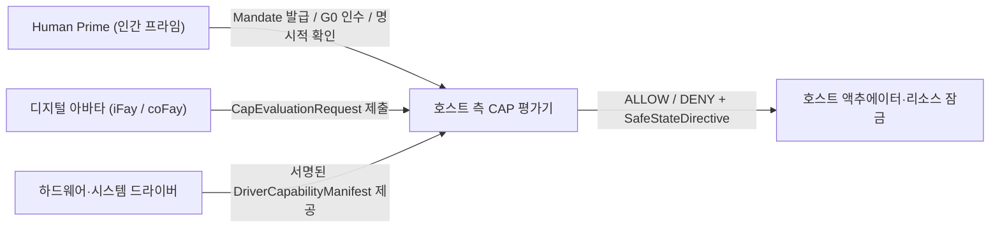

# 제1장: 아키텍처와 바인딩 모델

## 1.1 신뢰 모델과 신뢰 당사자(Relying Party) 위상

CAP은 독자적인 신원 루트나 인간 인가 발급 체계를 재정의해서는 안 되며(**SHALL NOT**), 호스트(`Host`) 신뢰 실행 경계 내부에서 동작하는 `Faying-Protocol`의 **신뢰 당사자(Relying Party)** 로 동작한다.

1. **`Human Prime`(인간 프라임)** 은 모든 제어 권한의 유일한 정당성 원천이며, 언제든지 조건 없이 호스트 제어권을 즉시 회수하는 `G0` 최우선 권한을 보유한다.
2. **호스트 측 드라이버(Driver)** 는 신뢰 앵커(Trust Anchor)로 Ed25519 서명된 `DriverCapabilityManifest`를 통해 각 리소스 작업의 위험도 하한과 안전 상태를 선언한다.
3. **디지털 아바타(`Fay`)** 는 프롬프트 인젝션, 컨텍스트 오염 또는 추론 환각에 노출될 수 있는 잠재적 비신뢰 호출자로 취급된다. CAP 평가기는 `Fay`가 자체 보고한 위험도 하향 요청이나 단말 증명이 없는 확인 주장을 신뢰해서는 안 된다(**MUST NOT**).

---

## 1.2 기본 거부(Default-Deny) 단락 평가 파이프라인

모든 `CapEvaluationRequest`에 대해 CAP 평가기는 다음 고정 순서로 결정론적 단락 평가를 수행해야 한다(**MUST**). 어느 단계에서든 조건을 충족하지 못하면 즉시 후속 단계를 중단하고 `DENY`를 반환해야 한다(**MUST**).

1. **프로토콜 버전 검증**: `protocol_version == "1.0"`인지 확인하며, 불일치 시 `E_PROTOCOL_VERSION_UNSUPPORTED`(`2098`)를 반환한다.
2. **프로토콜 범위 경계 차단**: 요청 최상위 `domain_category == "fund_transfer"`이면 즉시 `E_OUT_OF_SCOPE_FUND_TRANSFER`(`2007`)를 반환한다.
3. **드라이버 능력 매니페스트 서명 검증**: 로컬 신뢰 앵커 집합으로 `manifest`의 Ed25519 서명을 검증하며, 실패 시 `E_UNTRUSTED_MANIFEST`(`2005`)를 반환한다.
4. **작업 조회 및 유효 위험도 산출**: 검증된 매니페스트에서 `resource_id`와 `operation_id`를 조회하고(미선언 시 `E_UNKNOWN_OPERATION` `2004`, 작업의 `domain_category == "fund_transfer"` 시 `E_OUT_OF_SCOPE_FUND_TRANSFER` `2007`), 비가역성 하한과 단조 오버라이드를 적용해 `effective_criticality` 및 `escalation_clamped`를 확정한다.
5. **`G0` 긴급 인수 선점**: `g0_override == true` 또는 `grant.mandate_binding.session_grade == "G0"`이면 즉시 `E_G0_EMERGENCY_OVERRIDE`(`2003`)와 비차단 `safe_state_directive`를 반환한다.
6. **Faying Mandate 유효성 및 바인딩 모델 검증**: 만료 시각, 철회 플래그, 주체·리소스·접근 모드 일치를 검사하고(위반 시 `E_MANDATE_INVALID` `2008`), `effective_criticality`에 요구되는 바인딩 모델 강도를 검증한다(미달 시 `E_WEAK_MANDATE_BINDING` `2001`).
7. **3차원 등급 매트릭스 검증**: `session_grade`가 `grant.min_grade` 및 `FayingGrade × AccessMode × Criticality` 매트릭스를 충족하는지 확인하며, 미달 시 `E_GRADE_INSUFFICIENT`(`2002`)를 반환한다.
8. **매개변수 결합형 명시적 `Human Prime` 확인 게이트**: `effective_criticality`가 `high` 또는 `critical`일 때 `human_confirmation`의 식별자 정규식, 유효기간, 단말 고지 증명 및 매개변수 SHA-256 해시를 검증하며, 미충족 시 `E_CONFIRMATION_REQUIRED`(`2006`)를 반환한다.

위 8단계를 모두 통과한 경우에만 평가기는 `decision = "ALLOW"`와 함께 `effective_criticality`, `effective_grade`, `escalation_clamped`를 반환한다.

---

## 1.3 Faying Mandate 기본 정합성 불변식

`CapGrant.mandate_binding`(`MandateEvidence`)은 현재 요청에 결합된 상위 위임 상태를 나타낸다. 평가기는 다음 모든 불변식을 검증해야 하며(**MUST**), 하나라도 위반되면 `E_MANDATE_INVALID`(`2008`)를 반환해야 한다.

- `mandate.revoked == false`
- `mandate.expires_at_epoch_ms > req.now_epoch_ms`(현재 시각과 같거나 이전인 밀리초 타임스탬프는 만료로 판정)
- `mandate.fay_id == req.fay_id`
- `mandate.resource_id == req.resource_id` 및 `req.grant.resource_id == req.resource_id`
- 서명 검증된 매니페스트 내 대상 `OperationDescriptor.mode == req.requested_mode`
- `req.grant.allowed_modes`와 `mandate.allowed_modes` 모두 `req.requested_mode`를 포함함

---

## 1.4 3종 Mandate 바인딩 모델과 고위험 통제 규칙

CAP 1.0은 세 가지 `MandateBindingModel` 열거값을 정의하고 유효 위험도(`effective_criticality`)에 따라 강제 제약을 부과한다.

| 바인딩 모델 열거값 | 암호학적·온라인 요구사항 | 허용되는 최대 유효 위험도 | 위반 시 에러 코드 |
|--------------------|--------------------------|---------------------------|-------------------|
| `model_a_plus_b` | 온라인 신선도 검증 `online_fresh == true` **및** 현재 세션 암호화 파생 증명 `model_a_derived_proof_valid == true` | `routine`, `sensitive`, `high`, `critical`(**`high`·`critical`에서 유일하게 허용되는 모델**) | `high`/`critical`에서 `online_fresh != true` 또는 `model_a_derived_proof_valid != true`이면 `E_WEAK_MANDATE_BINDING`(`2001`); `routine`/`sensitive`에서 `online_fresh != true`이면 `E_MANDATE_INVALID`(`2008`) |
| `model_b_online_ref` | 온라인 Mandate 참조 및 실시간 철회·신선도 확인(`online_fresh == true` 필수) | `routine`, `sensitive`(CAP 1.0 기본 온라인 모델) | `high` 또는 `critical` 요청에 사용 시 **MUST** `E_WEAK_MANDATE_BINDING`(`2001`) 반환; `online_fresh != true`이면 `E_MANDATE_INVALID`(`2008`) |
| `model_c_offline_cache` | 단절 환경의 로컬 오프라인 캐시 증빙만 존재(실시간 신선도 확인 없음) | **`routine` 전용** | `sensitive`, `high`, `critical` 요청에 사용 시 **MUST** `E_WEAK_MANDATE_BINDING`(`2001`) 반환 |

**규범적 철칙**: 유효 위험도가 `high` 또는 `critical`인 호스트 작업은 오프라인 캐시(`model_c_offline_cache`)나 세션 파생 증명이 없는 단순 참조(`model_b_online_ref`)만으로 절대 허용해서는 안 된다(**SHALL NOT**).

---

## 1.5 금융 자금 이체 제외 경계

CAP은 물리 액추에이터, 운영체제 리소스, 통신 인터페이스, 스토리지 및 펌웨어 업데이트의 제어권 거버넌스만을 담당한다. 범용 장치 제어 채널이 금융 통제를 우회하는 결제 경로로 악용되는 것을 차단하기 위해, 등급이나 확인 증빙 여부와 무관하게 `CapEvaluationRequest.domain_category == "fund_transfer"` 또는 `OperationDescriptor.domain_category == "fund_transfer"`인 모든 요청에 대해 CAP 평가기는 조건 없이 `DENY`, `effective_criticality = "critical"`, `error_code = "E_OUT_OF_SCOPE_FUND_TRANSFER"`, `diagnostic_code = 2007`을 반환해야 한다(**MUST**).
