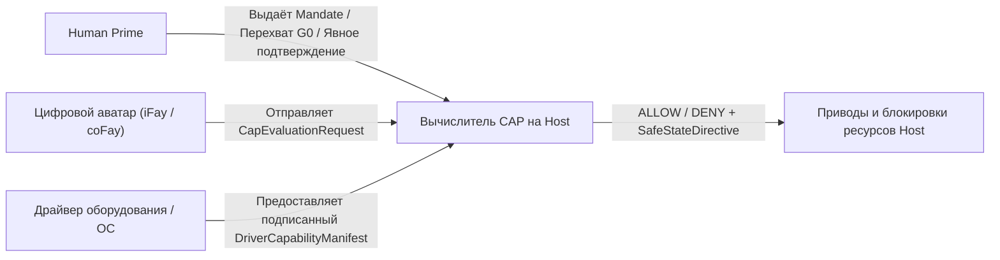

# Глава 1: Архитектура и модели привязки

## 1.1 Модель доверия и роль доверяющей стороны

CAP **НЕ ДОЛЖЕН** (**SHALL NOT**) формировать собственный корень идентичности или переопределять семантику делегирования от человека; протокол работает внутри доверенного контура исполнения **Host** как **доверяющая сторона** (*Relying Party*) по отношению к `Faying-Protocol`:

1. **Human Prime** (`Человек-прототип`) выступает единственным первоисточником легитимности управления и в любой момент сохраняет право мгновенного вытесняющего перехвата `G0` над Host.
2. **Драйвер Host** закрепляет непонижаемый порог критичности и перечень безопасных состояний каждой операции через подписанный алгоритмом Ed25519 документ `DriverCapabilityManifest`, привязанный к локальным якорям доверия (`Trust Anchors`).
3. **Цифровой аватар (`Fay`)** рассматривается как недоверенный вызывающий узел, подверженный инъекциям инструкций, отравлению контекста и сбоям рассуждений: вычислитель CAP **НЕ ДОЛЖЕН** (**MUST NOT**) доверять занижению критичности со стороны вызывающего узла или неподтверждённым заявлениям о согласии человека.

---

## 1.2 Детерминированный конвейер короткого замыкания (*Default-Deny*)

Для каждого входящего `CapEvaluationRequest` вычислитель CAP **ДОЛЖЕН** (**MUST**) выполнить приведённые восемь шагов строго по порядку; сбой на любом шаге **ДОЛЖЕН** (**MUST**) немедленно прервать проверку и вернуть `DENY`:

1. **Проверка версии протокола**: Убедиться, что `protocol_version == "1.0"`; иначе вернуть `E_PROTOCOL_VERSION_UNSUPPORTED` (`2098`).
2. **Фильтр границ применимости**: Если на верхнем уровне указано `domain_category == "fund_transfer"`, немедленно вернуть `E_OUT_OF_SCOPE_FUND_TRANSFER` (`2007`).
3. **Проверка подписи манифеста возможностей драйвера**: Проверить подпись Ed25519 объекта `manifest` по `trust_anchors`; при ошибке вернуть `E_UNTRUSTED_MANIFEST` (`2005`).
4. **Поиск операции и расчёт эффективной критичности**: Найти `resource_id` и `operation_id` в проверенном манифесте (при отсутствии вернуть `E_UNKNOWN_OPERATION` `2004`; если у операции указано `domain_category == "fund_transfer"`, вернуть `E_OUT_OF_SCOPE_FUND_TRANSFER` `2007`), затем вычислить `effective_criticality` и признак `escalation_clamped` на основе порога необратимости и монотонных переопределений.
5. **Экстренное вытеснение `G0` со стороны Human Prime**: Если `g0_override == true` или `grant.mandate_binding.session_grade == "G0"`, немедленно вернуть `E_G0_EMERGENCY_OVERRIDE` (`2003`) вместе с неблокирующей директивой `safe_state_directive`.
6. **Проверка действительности мандата Faying и модели привязки**: Проверить срок действия, флаг отзыва и совпадение субъекта, ресурса и режима (возвращая `E_MANDATE_INVALID` `2008` при расхождении), а затем сопоставить прочность модели привязки с `effective_criticality` (возвращая `E_WEAK_MANDATE_BINDING` `2001` при недостаточной привязке).
7. **Проверка трёхмерной матрицы уровней**: Убедиться, что `session_grade` удовлетворяет как `grant.min_grade`, так и матрице `FayingGrade × AccessMode × Criticality`; иначе вернуть `E_GRADE_INSUFFICIENT` (`2002`).
8. **Шлюз явного подтверждения Human Prime с привязкой к параметрам**: Если `effective_criticality` равен `high` или `critical`, проверить в `human_confirmation` формат идентификатора, срок годности, аттестацию раскрытия на стороне Host и SHA-256-хеш параметров; иначе вернуть `E_CONFIRMATION_REQUIRED` (`2006`).

Только при успешном прохождении всех восьми проверок вычислитель **ДОЛЖЕН** (**SHALL**) вернуть `decision = "ALLOW"` с заполненными полями `effective_criticality`, `effective_grade` и `escalation_clamped`.

---

## 1.3 Базовые инварианты согласованности мандата Faying

Поле `CapGrant.mandate_binding` (`MandateEvidence`) связывает запрос управления с активным вышестоящим делегированием. Вычислитель **ДОЛЖЕН** (**MUST**) проверить все перечисленные условия и вернуть `E_MANDATE_INVALID` (`2008`) при нарушении любого из них:

- `mandate.revoked == false`;
- `mandate.expires_at_epoch_ms > req.now_epoch_ms` (отметка меньше либо равная `now_epoch_ms` считается истёкшей);
- `mandate.fay_id == req.fay_id`;
- `mandate.resource_id == req.resource_id` и `req.grant.resource_id == req.resource_id`;
- `OperationDescriptor.mode == req.requested_mode` в проверенном манифесте;
- Списки `req.grant.allowed_modes` и `mandate.allowed_modes` одновременно содержат `req.requested_mode`.

---

## 1.4 Модели привязки мандата и ограничения высокой критичности

CAP 1.0 определяет три варианта `MandateBindingModel`, допустимость которых зависит от `effective_criticality`:

| Модель привязки | Требования к криптографии и свежести | Максимально допустимая критичность | Код ошибки при нарушении |
|-----------------|--------------------------------------|------------------------------------|--------------------------|
| `model_a_plus_b` | Живая свежесть мандата `online_fresh == true` **И** сеансовое производное криптодоказательство `model_a_derived_proof_valid == true` | `routine`, `sensitive`, `high`, `critical` (**единственная допустимая модель для `high` и `critical`**) | `E_WEAK_MANDATE_BINDING` (`2001`), если при `high`/`critical` не выполнено `online_fresh == true` или `model_a_derived_proof_valid == true`; `E_MANDATE_INVALID` (`2008`), если при `routine`/`sensitive` нарушено `online_fresh == true` |
| `model_b_online_ref` | Активная ссылка на Mandate с проверкой отзыва и свежести в реальном времени (`online_fresh == true`) | `routine`, `sensitive` (штатный онлайн-режим CAP 1.0 по умолчанию) | **ДОЛЖЕН** (`MUST`) вернуть `E_WEAK_MANDATE_BINDING` (`2001`) при `high` или `critical`; возвращает `E_MANDATE_INVALID` (`2008`), если `online_fresh != true` |
| `model_c_offline_cache` | Локально кешированный офлайн-мандат без онлайн-подтверждения свежести | **только `routine`** | **ДОЛЖЕН** (`MUST`) вернуть `E_WEAK_MANDATE_BINDING` (`2001`) при `sensitive`, `high` или `critical` |

**Нормативный инвариант**: Реализация на стороне Host **НЕ ДОЛЖНА** (**SHALL NOT**) одобрять операции уровней `high` и `critical` по офлайн-кешу (`model_c_offline_cache`) либо по онлайн-ссылке без производного сеансового доказательства (`model_b_online_ref`).

---

## 1.5 Исключение финансовых переводов средств

CAP управляет физическими приводами, ресурсами операционной системы, интерфейсами связи, накопителями и обновлением прошивок. Чтобы универсальные каналы управления оборудованием не использовались в обход специализированных контуров финансового контроля:

- Независимо от уровня сеанса и наличия подтверждений, если `CapEvaluationRequest.domain_category == "fund_transfer"` или `OperationDescriptor.domain_category == "fund_transfer"`, вычислитель CAP **ДОЛЖЕН** (**MUST**) безусловно отклонить запрос с `effective_criticality = "critical"`, `error_code = "E_OUT_OF_SCOPE_FUND_TRANSFER"` и `diagnostic_code = 2007`.
