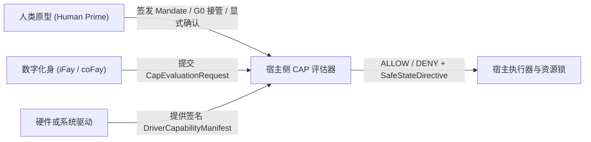

# 第 1 章：架构与绑定模型

## 1.1 信任模型与依赖方定位

CAP **SHALL NOT** 自建独立的身份根或人类授权签发体系，而是作为 `Faying-Protocol` 的**依赖方（Relying Party）**运行在宿主（`Host`）可信执行边界内：

1. **人类原型（Human Prime）** 是所有控制权合法性的唯一源头，随时保有无条件抢占宿主控制权的 `G0` 最高特权。
2. **宿主侧驱动（Driver）** 通过经可信锚点（Trust Anchor）Ed25519 签名的 `DriverCapabilityManifest` 声明宿主资源的操作危重度底线与安全态。
3. **数字化身（Fay）** 被视为潜在不可信调用方（可能遭受提示词注入、上下文污染或推理偏差）：CAP 评估器 **MUST NOT** 采信 `Fay` 自报的危重度降级请求或未经终端证明的确认声明。

---

## 1.2 默认拒绝（Default-Deny）短路评估流水线

对于每一次控制请求 `CapEvaluationRequest`，CAP 评估器 **MUST** 按以下固定顺序执行确定性短路判定；任一步骤未通过时 **MUST** 立即终止后续步骤并返回 `DENY`：

1. **协议版本核验**：要求 `protocol_version == "1.0"`，否则返回 `E_PROTOCOL_VERSION_UNSUPPORTED`（`2098`）。
2. **协议范围边界拦截**：若请求顶层 `domain_category == "fund_transfer"`，立即返回 `E_OUT_OF_SCOPE_FUND_TRANSFER`（`2007`）。
3. **驱动能力清单验签**：使用本地信任锚集合校验 `manifest` 的 Ed25519 签名，失败则返回 `E_UNTRUSTED_MANIFEST`（`2005`）。
4. **操作定位与有效危重度计算**：在已验签清单中检索 `resource_id` 与 `operation_id`（未声明则返回 `E_UNKNOWN_OPERATION` `2004`；若操作本身声明 `domain_category == "fund_transfer"` 亦返回 `E_OUT_OF_SCOPE_FUND_TRANSFER` `2007`），叠加不可逆地板与单调覆盖值得到 `effective_criticality` 与 `escalation_clamped`。
5. **`G0` 人类原型紧急接管抢占**：若 `g0_override == true` 或 `grant.mandate_binding.session_grade == "G0"`，立即返回 `E_G0_EMERGENCY_OVERRIDE`（`2003`）并附带非阻塞 `safe_state_directive`。
6. **Faying Mandate 有效性及绑定模型核验**：校验过期时间、撤销位、主体/资源/访问模式一致性（不满足返回 `E_MANDATE_INVALID` `2008`），并按 `effective_criticality` 校验绑定模型强度（不满足返回 `E_WEAK_MANDATE_BINDING` `2001`）。
7. **三维分级矩阵核验**：校验 `session_grade` 是否同时满足 `grant.min_grade` 与 `FayingGrade × AccessMode × Criticality` 矩阵，否则返回 `E_GRADE_INSUFFICIENT`（`2002`）。
8. **参数绑定显式人类原型确认门**：当 `effective_criticality` 为 `high` 或 `critical` 时，强制核验 `human_confirmation` 的身份格式、时效、终端披露位与参数 SHA-256 摘要，否则返回 `E_CONFIRMATION_REQUIRED`（`2006`）。

仅当上述 8 步全部通过时，评估器方可返回 `decision = "ALLOW"`，并回填 `effective_criticality`、`effective_grade` 与 `escalation_clamped`。

---

## 1.3 Faying Mandate 基础一致性要求

`CapGrant.mandate_binding`（`MandateEvidence`）记录与当前请求绑定的上游委任状态。评估器 **MUST** 验证以下全部不变量，任一违反均返回 `E_MANDATE_INVALID`（`2008`）：

- `mandate.revoked == false`；
- `mandate.expires_at_epoch_ms > req.now_epoch_ms`（已达或超过到期毫秒时间戳即视为过期）；
- `mandate.fay_id == req.fay_id`；
- `mandate.resource_id == req.resource_id` 且 `req.grant.resource_id == req.resource_id`；
- 已验签驱动清单中该 `OperationDescriptor.mode == req.requested_mode`；
- `req.grant.allowed_modes` 与 `mandate.allowed_modes` 均包含 `req.requested_mode`。

---

## 1.4 三种 Mandate 绑定模型与高危安全门禁

CAP 1.0 定义三种 `MandateBindingModel` 枚举取值，并按操作的有效危重度（`effective_criticality`）实施强制分级约束：

| 绑定模型枚举 | 密码学与在线要求 | 允许的最高有效危重度 | 违规错误码 |
|-------------|-----------------|---------------------|-----------|
| `model_a_plus_b` | 在线新鲜度核验 `online_fresh == true` **且** 当前会话密码学派生证明 `model_a_derived_proof_valid == true` | `routine`、`sensitive`、`high`、`critical`（全等级可用，**`high` 与 `critical` 唯一合法模型**） | 若 `high`/`critical` 下 `online_fresh != true` 或 `model_a_derived_proof_valid != true`，返回 `E_WEAK_MANDATE_BINDING`（`2001`）；若 `routine`/`sensitive` 下 `online_fresh != true`，返回 `E_MANDATE_INVALID`（`2008`） |
| `model_b_online_ref` | 在线 Mandate 引用与实时撤销/新鲜度检查（要求 `online_fresh == true`） | `routine`、`sensitive`（CAP 1.0 默认在线基线） | 用于 `high` 或 `critical` 时 **MUST** 返回 `E_WEAK_MANDATE_BINDING`（`2001`）；`online_fresh != true` 时返回 `E_MANDATE_INVALID`（`2008`） |
| `model_c_offline_cache` | 断网环境下的纯本地缓存授权凭证（无实时在线新鲜度证明） | **仅限 `routine`** | 用于 `sensitive`、`high` 或 `critical` 时 **MUST** 返回 `E_WEAK_MANDATE_BINDING`（`2001`） |

**规范性铁律**：任何 `high` 或 `critical` 级别的宿主操作 **SHALL NOT** 仅凭离线缓存（`model_c_offline_cache`）或无会话派生证明的普通引用（`model_b_online_ref`）放行。

---

## 1.5 金融资金划转排除边界

CAP 专职管理物理执行器、操作系统资源、通信接口、存储介质与固件更新控制权。为防止通用设备控制通道被滥用为绕过金融风控的支付旁路：

- 无论请求持有何种等级（即便为 `G1` + `model_a_plus_b` + 有效人类原型确认），只要 `CapEvaluationRequest.domain_category == "fund_transfer"` 或目标 `OperationDescriptor.domain_category == "fund_transfer"`，CAP 评估器 **MUST** 无条件拒绝，返回 `effective_criticality = "critical"`、`error_code = "E_OUT_OF_SCOPE_FUND_TRANSFER"` 与 `diagnostic_code = 2007`。
