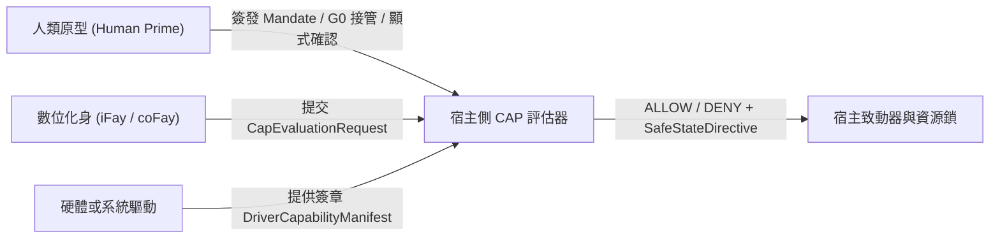

# 第 1 章：架構與綁定模型

## 1.1 信任模型與依賴方定位

CAP **SHALL NOT** 自建獨立的身分根或人類授權簽發體系，而是作為 `Faying-Protocol` 的**依賴方（Relying Party）**運作於宿主（`Host`）可信執行邊界內：

1. **人類原型（Human Prime）** 是所有控制權合法性的唯一源頭，隨時保有無條件搶佔宿主控制權的 `G0` 最高特權。
2. **宿主側驅動（Driver）** 透過經可信錨點（Trust Anchor）Ed25519 簽章的 `DriverCapabilityManifest` 宣告宿主資源的操作危重度底線與安全態。
3. **數位化身（Fay）** 被視為潛在不可信呼叫方（可能遭受提示詞注入、上下文污染或推理偏差）：CAP 評估器 **MUST NOT** 採信 `Fay` 自報的危重度降級請求或未經終端證明的確認宣告。

---

## 1.2 預設拒絕（Default-Deny）短路評估管線

對於每一次控制請求 `CapEvaluationRequest`，CAP 評估器 **MUST** 按以下固定順序執行確定性短路判定；任一步驟未通過時 **MUST** 立即終止後續步驟並回傳 `DENY`：

1. **協定版本核驗**：要求 `protocol_version == "1.0"`，否則回傳 `E_PROTOCOL_VERSION_UNSUPPORTED`（`2098`）。
2. **協定範圍邊界攔截**：若請求頂層 `domain_category == "fund_transfer"`，立即回傳 `E_OUT_OF_SCOPE_FUND_TRANSFER`（`2007`）。
3. **驅動能力清單驗簽**：使用本地信任錨集合校驗 `manifest` 的 Ed25519 數位簽章，失敗則回傳 `E_UNTRUSTED_MANIFEST`（`2005`）。
4. **操作定位與有效危重度計算**：在已驗簽清單中檢索 `resource_id` 與 `operation_id`（未宣告則回傳 `E_UNKNOWN_OPERATION` `2004`；若操作本身宣告 `domain_category == "fund_transfer"` 亦回傳 `E_OUT_OF_SCOPE_FUND_TRANSFER` `2007`），疊加不可逆地板與單調覆寫值得到 `effective_criticality` 與 `escalation_clamped`。
5. **`G0` 人類原型緊急接管搶佔**：若 `g0_override == true` 或 `grant.mandate_binding.session_grade == "G0"`，立即回傳 `E_G0_EMERGENCY_OVERRIDE`（`2003`）並附帶非阻塞 `safe_state_directive`。
6. **Faying Mandate 有效性及綁定模型核驗**：校驗到期時間、撤銷位元、主體/資源/存取模式一致性（不滿足回傳 `E_MANDATE_INVALID` `2008`），並按 `effective_criticality` 校驗綁定模型強度（不滿足回傳 `E_WEAK_MANDATE_BINDING` `2001`）。
7. **三維分級矩陣核驗**：校驗 `session_grade` 是否同時滿足 `grant.min_grade` 與 `FayingGrade × AccessMode × Criticality` 矩陣，否則回傳 `E_GRADE_INSUFFICIENT`（`2002`）。
8. **參數綁定顯式人類原型確認門**：當 `effective_criticality` 為 `high` 或 `critical` 時，強制核驗 `human_confirmation` 的身分格式、時效、終端揭露位元與參數 SHA-256 雜湊摘要，否則回傳 `E_CONFIRMATION_REQUIRED`（`2006`）。

僅當上述 8 步全部通過時，評估器方可回傳 `decision = "ALLOW"`，並回填 `effective_criticality`、`effective_grade` 與 `escalation_clamped`。

---

## 1.3 Faying Mandate 基礎一致性要求

`CapGrant.mandate_binding`（`MandateEvidence`）記錄與當前請求綁定的上游委任狀態。評估器 **MUST** 驗證以下全部不變量，任一違反均回傳 `E_MANDATE_INVALID`（`2008`）：

- `mandate.revoked == false`；
- `mandate.expires_at_epoch_ms > req.now_epoch_ms`（已達或超過到期毫秒時間戳記即視為過期）；
- `mandate.fay_id == req.fay_id`；
- `mandate.resource_id == req.resource_id` 且 `req.grant.resource_id == req.resource_id`；
- 已驗簽驅動清單中該 `OperationDescriptor.mode == req.requested_mode`；
- `req.grant.allowed_modes` 與 `mandate.allowed_modes` 均包含 `req.requested_mode`。

---

## 1.4 三種 Mandate 綁定模型與高危安全門禁

CAP 1.0 定義三種 `MandateBindingModel` 列舉取值，並按操作的有效危重度（`effective_criticality`）實施強制分級約束：

| 綁定模型列舉 | 密碼學與線上要求 | 允許的最高有效危重度 | 違規錯誤碼 |
|-------------|-----------------|---------------------|-----------|
| `model_a_plus_b` | 線上新鮮度核驗 `online_fresh == true` **且** 當前會話密碼學派生證明 `model_a_derived_proof_valid == true` | `routine`、`sensitive`、`high`、`critical`（全等級可用，**`high` 與 `critical` 唯一合法模型**） | 若 `high`/`critical` 下 `online_fresh != true` 或 `model_a_derived_proof_valid != true`，回傳 `E_WEAK_MANDATE_BINDING`（`2001`）；若 `routine`/`sensitive` 下 `online_fresh != true`，回傳 `E_MANDATE_INVALID`（`2008`） |
| `model_b_online_ref` | 線上 Mandate 引用與即時撤銷/新鮮度檢查（要求 `online_fresh == true`） | `routine`、`sensitive`（CAP 1.0 預設線上基線） | 用於 `high` 或 `critical` 時 **MUST** 回傳 `E_WEAK_MANDATE_BINDING`（`2001`）；`online_fresh != true` 時回傳 `E_MANDATE_INVALID`（`2008`） |
| `model_c_offline_cache` | 斷網環境下的純本地快取授權憑證（無即時線上新鮮度證明） | **僅限 `routine`** | 用於 `sensitive`、`high` 或 `critical` 時 **MUST** 回傳 `E_WEAK_MANDATE_BINDING`（`2001`） |

**規範性鐵律**：任何 `high` 或 `critical` 級別的宿主操作 **SHALL NOT** 僅憑離線快取（`model_c_offline_cache`）或無會話派生證明的普通引用（`model_b_online_ref`）放行。

---

## 1.5 金融資金劃轉排除邊界

CAP 專職管理實體致動器、作業系統資源、通訊介面、儲存媒體與韌體更新控制權。為防止通用設備控制通道被濫用為繞過金融風控的支付旁路：

- 無論請求持有何種等級（即便為 `G1` + `model_a_plus_b` + 有效人類原型確認），只要 `CapEvaluationRequest.domain_category == "fund_transfer"` 或目標 `OperationDescriptor.domain_category == "fund_transfer"`，CAP 評估器 **MUST** 無條件拒絕，回傳 `effective_criticality = "critical"`、`error_code = "E_OUT_OF_SCOPE_FUND_TRANSFER"` 與 `diagnostic_code = 2007`。
